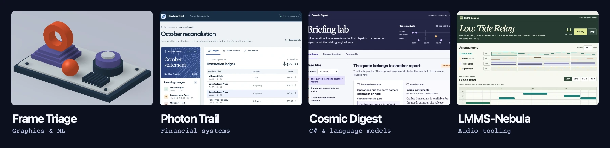

# Aladdin Ali

I started in game graphics, where a single bad frame could take longer to explain than it took to render. I bring that debugging habit to C# services and applied AI. When a briefing makes a claim or a bank feed changes yesterday's transaction, I want to recover the inputs and replay the decision.

**[Explore the interactive portfolio](https://naxe.dev/)** · [Watch the 40-second tour](https://naxe.dev/projects/#tour) · [Engineering background](https://naxe.dev/about/) · [Email](mailto:aladdin@naxe.dev)

### Selected work

| Project | What you can try |
| --- | --- |
| **[Frame Triage](https://naxe.dev/labs/frame-triage/)** · Graphics and ML | Drag between two renders to find a missing component. Compare a trained detector with an aligned pixel baseline, then open a real false alarm. The workbench also runs on your own screenshot pairs. [Renderer, model and held-out decisions](https://github.com/NaxeCode/Minnen/tree/3d9c78b818cc8f43c3261f3969b4899e72db172a/tools/frame-triage) |
| **[Photon Trail](https://naxe.dev/labs/photon-trail/)** · Financial systems | Two charges have the same amount. Read the receipt, select the right entry, interrupt a bank import and replay it. The connected sync has a PostgreSQL integration test for the checkpoint and the operator's correction. [Implementation](https://github.com/NaxeCode/Photon-Trail/pull/9/files) |
| **[Cosmic Digest](https://naxe.dev/labs/cosmic-digest/)** · .NET and applied AI | Follow a quotation back to the selected report. Inspect a false conclusion that passes the quote check, then follow the C# service through a rejected response and deterministic fallback. [Evidence guard](https://github.com/NaxeCode/Cosmic-Digest/pull/15/files) · [Ambiguous email delivery test](https://github.com/NaxeCode/Cosmic-Digest/blob/1a9afe2d27220256699ecd9c348109b49c1f77de/tests/CosmicDigest.Tests/DigestIdempotencyTests.cs) |
| **[LMMS-Nebula](https://naxe.dev/labs/lmms-session/)** · Audio tools | Play a four-part game-music loop, edit a note and export a native project. The fork extends the open-source LMMS workstation with a local control socket and Python/MCP adapter. [Editor and score](https://github.com/NaxeCode/lmms-nebula/pull/1/files) · [Upstream LMMS](https://github.com/LMMS/lmms) |

For released desktop software, see [ActivityMux](https://github.com/NaxeCode/activitymux/releases). For a team project, see [Kruu’s scheduling demo and crew credits](https://github.com/NaxeCode/heatshift#the-crew-behind-kruu).

Based in Florida and open to U.S. relocation for applied AI, senior .NET and hybrid engineering roles.
